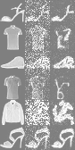
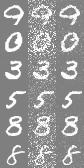
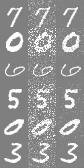

# 条件去噪扩散模型（CDiff）用于图像重建

> 以「退化图像」为条件的去噪扩散概率模型（DDPM）实现：不要求从纯高斯噪声开始生成，而是把退化的观测图像作为条件注入扩散过程，逐步去噪恢复干净图像。

**English abstract.** A PyTorch implementation of conditional denoising diffusion probabilistic models (CDiff) for image reconstruction. Instead of assuming that the reverse process starts from isotropic Gaussian noise, the degraded observation is injected into the forward diffusion as a conditioning signal and used to initialize the reverse chain, so the model learns a *degraded-to-clean* transformation. The repository contains the conditional diffusion formulation, a U-Net noise predictor with time embeddings and linear attention, configurable noise/weighting schedules and losses, a training pipeline with EMA/early-stopping options, and a noisy-pair dataset that samples a random SNR for every sample.

## 背景与思路

在数字通信中，接收端解码得到的图像是原始图像的**退化版本**（受噪声、衰落与收发机硬件损伤影响），而不是纯各向同性高斯噪声。标准 DDPM 的反向过程从纯噪声出发，与这一物理事实不匹配；若直接套用，要么重建质量受限，要么只能靠降低信道编码码率换取可靠性，牺牲有效传输速率。

本项目的处理方式是**条件化**：把退化图像 `x̂` 同时作为

1. 前向扩散中的条件项（与干净图像 `x0` 按权重 `λ_t` 混合），以及
2. 反向采样链的起点（在最高时间步用 `x̂` 初始化，而不是纯噪声），

让扩散模型学习「从退化观测到干净图像」的映射，从而在不增加冗余比特的前提下提升接收端重建质量。

## 方法

### 条件前向过程

```
x_t = (1 - λ_t)·√ᾱ_t·x0 + λ_t·√ᾱ_t·x̂ + √δ_t·ε,    ε ~ N(0, I)
δ_t = (1 - ᾱ_t) - λ_t²·ᾱ_t
```

其中 `ᾱ_t` 为累积 alpha，`λ_t` 为条件权重。代码中 `λ_t` 取解析形式 `√((1-ᾱ_t)/√ᾱ_t)`，`q_sample()` 实现上式。

### 条件反向过程

反向均值由 ELBO 推导出的闭式系数给出：

```
x_{t-1} = Ψ_x·x_t + Ψ_x̂·x̂ - Ψ_ε·ε_θ(x_t, x̂, t) + √δ̂_t·z
```

`Ψ_x`、`Ψ_x̂`、`Ψ_ε` 与后验方差 `δ̂_t` 在 `p_sample()` 中按时间步逐项计算；采样从 `t = T` 开始，起点为 `√ᾱ_T·x̂ + √δ_T·ε`。

### 噪声预测网络

`noisePredictModels/Unet/UNet.py` 中的 U-Net：

- 正弦位置编码 → MLP 的时间嵌入，注入每个残差块；
- 权重标准化卷积 + GroupNorm + SiLU；
- 下采样用 space-to-depth + 1×1 卷积（避免步长卷积/池化）；
- 每层线性注意力，中间层全注意力；
- 输入为 `[x_t, x̂]` 双通道堆叠，输出单通道噪声预测。

### 训练目标

```
ε_θ(x_t, x̂, t) ≈ ε
```

损失支持 `l1` / `l2` / `huber`，训练脚本默认使用 `huber`。

### 可配置项

| 组件 | 可选值 | 位置 |
| --- | --- | --- |
| 噪声调度 `β_t` | linear / cosine / quadratic / sigmoid | `diffusionModels/denoisingDiffusion/varianceSchedule.py` |
| 条件权重 `λ_t` | linear / cosine / quadratic / sigmoid | `diffusionModels/denoisingDiffusion/weigthSchedule.py` |
| 损失函数 | l1 / l2 / huber | `compute_loss(loss_type=...)` |
| 训练技巧 | EMA、早停、分段学习率 | `utils/trainNetworkHelper.py` |

## 项目结构

```
.
├── diffusionModels/
│   ├── denoisingDiffusion/        # 条件扩散模型（本项目核心）
│   │   ├── denoisingDiffusion.py  # 条件前向/反向过程、损失、采样
│   │   ├── varianceSchedule.py    # β_t 调度
│   │   └── weigthSchedule.py      # λ_t 调度
│   └── simpleDiffusion/           # 原始 DDPM（生成基线）
├── noisePredictModels/Unet/UNet.py# 噪声预测 U-Net
├── utils/
│   ├── networkHelper.py           # 网络组件、SNR 加噪、成对数据集
│   └── trainNetworkHelper.py      # 训练器、EMA、早停、学习率调整
├── saved_denoising_train_models/  # 条件扩散权重（200 / 1000 步）
├── saved_train_models/            # 原始 DDPM 权重（1000 步）
├── denoising_results*.png         # 重建效果可视化
├── image_denoising_test.py        # 条件去噪训练 + 可视化入口
├── image_test.py                  # 原始 DDPM 训练 + 采样入口
├── evaluate.py                    # PSNR / SSIM 评测脚本
├── requirements.txt
└── LICENSE
```

## 环境依赖

```bash
pip install -r requirements.txt
```

- Python 3.8+
- PyTorch / torchvision（CPU 或 CUDA 均可，脚本自动选择 `cuda`）
- `einops`、`tqdm`、`numpy`、`Pillow`

## 数据准备

MNIST 与 FashionMNIST 由 `torchvision.datasets` 自动下载到 `./dataset/`，无需手动准备。

`utils/networkHelper.py` 中的 `StackedNoisyDataset` 会在每个样本上**独立采样**一个 SNR（默认 `-5 ~ 5 dB`，按 dB 均匀），叠加高斯噪声并按 `[0,1]` 截断，返回 `[干净图像; 退化图像]` 双通道张量。逐样本随机 SNR 使单一模型即可覆盖较宽的噪声范围。

## 训练

```bash
# 条件去噪扩散（FashionMNIST，200 步）
python image_denoising_test.py

# 原始 DDPM 生成基线（MNIST，1000 步）
python image_test.py
```

主要超参数（`image_denoising_test.py`）：

| 参数 | 值 |
| --- | --- |
| 图像尺寸 / 通道 | 28×28 / 2 → 1 |
| 扩散步数 `T` | 200（另有权重为 1000 步） |
| `β` 范围 | 1e-4 ~ 9.5e-3（线性） |
| 批大小 / 轮数 | 64 / 20 |
| 优化器 / 学习率 | Adam / 1e-3 |
| U-Net 通道倍增 | (1, 2, 4) |
| EMA 衰减 | 0.995 |

训练完成后权重保存为 `saved_denoising_train_models/<配置名>/BestModel.pth`（约 8.2 MB，≈2.04 M 参数）。

## 推理与可视化

`image_denoising_test.py` 末尾默认「训练 → 采样 → 出图」。若只想用已训练权重推理：

1. 注释掉 `DDPM = Trainer(DDPM, model_save_path=saved_path)`；
2. 取消注释加载权重的两行 `DDPM.load_state_dict(torch.load(best_model_path))`。

脚本会随机抽取若干样本，按「原图 | 退化图 | 重建图」三列拼接，保存为 `denoising_results_4.png`。

## 结果

在 `-5 ~ 5 dB` 的随机噪声下（中间列为严重失真的退化图），条件扩散模型仍能重建出结构完整的目标。每行从左到右：**原图 | 退化图 | 重建图**。

FashionMNIST：



MNIST：





## 评测

`evaluate.py` 会在测试集上按指定 SNR 生成退化图，统计「退化图 PSNR」与「重建图 PSNR / SSIM」，直接给出增益，而不是靠看图估计：

```bash
# 200 步权重（默认配置）
python evaluate.py --num-images 64 --snrs -5 0 5 10 --csv results_200.csv

# 1000 步权重：注意同时指定 --timesteps 与 --beta-end
python evaluate.py --timesteps 1000 --beta-end 0.02 \
  --ckpt "saved_denoising_train_models/imageSize28_channels1_dimMults(1, 2, 4)_timeSteps1000_scheduleNamelinear_beta_schedule_weightScheduleNamelinear_lamda_schedule/BestModel.pth"
```

终端会逐行打印每个 SNR 的结果，并输出可直接粘进 README 或简历的 Markdown 表格（数值由实际运行产生）：

| SNR (dB) | degraded PSNR | reconstructed PSNR | gain | SSIM |
| --- | --- | --- | --- | --- |
| -5.0 | 运行后填入 | 运行后填入 | 运行后填入 | 运行后填入 |

注意：`--timesteps` 必须与权重匹配（200 步权重配 200、1000 步权重配 1000），否则噪声调度不一致，结果不可用。

## 实现说明与 Roadmap

- **信道模型**：使用「AWGN + 逐样本随机 SNR」等效替代论文中的 Sionna + 5G LDPC + 硬件损伤链路，本仓库聚焦条件扩散重建模块本身。
  - Roadmap：接入 Sionna，补 16-QAM + 5G LDPC 的完整链路。
- **训练标签**：`compute_loss()` 已实现复合目标 `noise_condition`（残差 `x̂ - x0` 与高斯噪声的线性组合），但当前训练仍以纯高斯噪声为标签。
  - Roadmap：改用复合目标并做 PSNR/SSIM 对比，这是最直接的一次精度提升。
- **评测**：已提供 `evaluate.py`（PSNR / SSIM / 增益），但尚无与 VAE、DNN 接收机的横向对比。
  - Roadmap：补 VAE 基线，形成论文式的对比曲线。
- **EMA**：训练器实现了 EMA 参数滑动更新，但保存与推理仍使用原始权重。
  - Roadmap：导出 EMA 权重并验证其增益。
- **采样效率**：目前固定跑满 `T` 步。
  - Roadmap：接入 DDIM / DPM-Solver 少步采样，并给出「步数–质量」曲线。

## 参考

- M. Letafati, S. Ali, M. Latva-aho, "Conditional Denoising Diffusion Probabilistic Models for Data Reconstruction Enhancement in Wireless Communications," *IEEE Transactions on Machine Learning in Communications and Networking*, vol. 3, 2025. DOI: 10.1109/TMLCN.2024.3522872
- J. Ho, A. Jain, P. Abbeel, "Denoising Diffusion Probabilistic Models," *NeurIPS*, 2020.
- NVIDIA Sionna: https://github.com/NVlabs/sionna

> 论文原文受 IEEE 版权保护，未包含在本仓库中，请通过 DOI 获取。

## License

[MIT](LICENSE) © 2026 jb111learner
